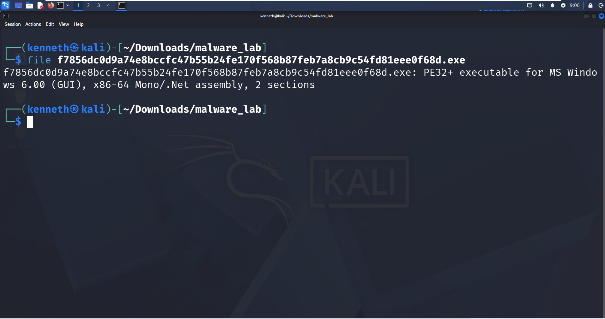
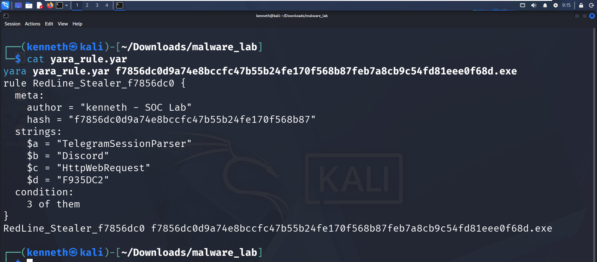

# RedLine Stealer - Static Triage & YARA Detection


**Analyst:** Kenneth Mbogu | kenmbogu@gmail.com  
**Lab:** Isolated Kali Linux VM (Offline)  
**Date:** October 2026

## Overview
Static triage and detection engineering for RedLine Infostealer - a commodity .NET credential stealer targeting browsers, crypto wallets, Discord tokens, and Telegram sessions. This lab demonstrates SOC triage workflow from file identification to custom YARA detection.

**Sample**
- **SHA256:** `f7856dc0d9a74e8bccfc47b55b24fe170f568b87feb7a8cb9c54fd81eee0f68d`
- **Size:** 322 KB
- **Type:** PE32+ x64 (GUI) - Mono/.NET Assembly

## Evidence

### 1. Static File Identification
Initial file triage confirms .NET packed binary with section anomaly (2 sections vs normal 4+).



### 2. YARA Detection - Verified Hit
Custom YARA rule successfully detects the sample.



## Technical Findings

**Packing / Obfuscation:**
- 2 sections only - indicator of packing
- asInvoker manifest
- .NET obfuscation / ConfuserEx artifacts

**Key IoCs Extracted:**
- `TelegramSessionParser` - Telegram session hijacking module
- `Discord` token stealer
- `HttpWebRequest` / `HttpStatusCode` - HTTP C2 exfiltration
- GUID `F935DC21` - COM access for browser data theft
- Base64 encoded C2 blobs

**Inferred Capabilities:**
- Browser credential & cookie theft
- Cryptocurrency wallet stealing
- Discord & Telegram session theft
- Data exfiltration via HTTP POST

## Detection

### YARA Rule (`yara_rule.yar`)
```yara
import "pe"

rule RedLine_Stealer_Kenneth_Triage {
    meta:
        author = "Kenneth Mbogu"
        hash = "f7856dc0d9a74e8bccfc47b55b24fe170f568b87feb7a8cb9c54fd81eee0f68d"
        description = "Detects RedLine Stealer .NET variant - SOC Triage Lab"
        date = "2026-10-27"
    strings:
        $telegram = "TelegramSessionParser" ascii wide
        $discord = "Discord" ascii wide nocase
        $http_req = "HttpWebRequest" ascii wide
        $guid = "F935DC21" ascii wide
    condition:
        uint16(0) == 0x5A4D and pe.is_pe and 3 of them
}Splunk / Sysmon Hunt (SOC)splindex=sysmon EventCode=1 Image="*\\f7856dc0*"
| table _time, Computer, User, CommandLine, ParentImage

index=sysmon EventCode=3 Image="*f7856dc0*"
| stats count by dest_ip, dest_port, ComputerTools UsedKali Linux, file, strings, floss, pe-bear, die, YARASafety & EthicsAnalyzed 100% offline in isolated VMSample never executedNo live malware binaries in repository - only hashes, IoCs, and detection logicSkills DemonstratedStatic Malware Triage | YARA Rule Development | IoC Extraction | Detection Engineering | SOC Threat HuntingPortfolio Project 1 / SOC Analyst Trackjavascript
